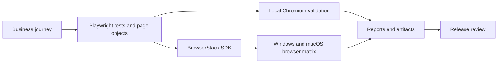

# Architecture overview

This repository provides a controlled path from local Playwright tests to repeatable cross-browser evidence in BrowserStack and GitHub Actions.

## Operating model

- **Local-first feedback:** developers can validate journeys without consuming cloud sessions.
- **Cloud browser matrix:** BrowserStack runs the same business tests across selected browser and operating-system combinations.
- **Secure configuration:** credentials stay in environment variables or GitHub secrets.
- **Reviewable failures:** HTML, JUnit, traces, screenshots and video support investigation.
- **Adoption controls:** runbooks cover planning, release gates, security, ownership and incident handling.

## Reviewer path

1. Read the main `README.md` for the five-minute start.
2. Review the fixtures, page objects and tagged test templates.
3. Inspect `browserstack.yml` and the GitHub Actions workflow.
4. Read the business-readiness and operations runbooks under `docs/`.

## Boundaries

The included journeys are generic demonstrations. A real adoption requires organisation-specific critical paths, supported-browser policy, test data ownership, concurrency limits, release thresholds and a maintained triage process.
